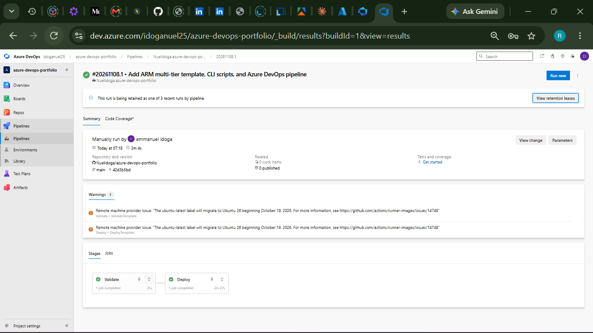

@'
# Azure DevOps Portfolio

Three connected projects that deploy a two-tier Azure environment.

## Projects
1. **ARM multi-tier template** (`arm-multitier/`): App Service plan, web app, and Azure SQL database.
2. **CLI automation scripts** (`cli-scripts/`): PowerShell scripts that create the resource group, deploy the template, and clean up.
3. **Azure DevOps pipeline** (`pipeline/`): YAML pipeline with a Validate stage and a Deploy stage, using a service connection and a secret variable for the SQL password.

## How to run
1. Run `az login`.
2. Set your SQL password in the terminal: `$env:SQL_PASSWORD = '<your-password>'`
3. Go into the scripts folder: `cd cli-scripts`
4. Run `.\deploy.ps1 -Location westus3`

## Pipeline result

## What I learned
- **Regions can be blocked.** My first deployments failed with "region not accepting new customers". I learned that Azure restrictions differ by region and subscription, so I tested other regions until westus3 worked.
- **A resource group's region can't be changed.** Re-running my script with a new region kept failing because the old group already existed. I fixed it by deleting the group first and naming each group after its region.
- **Quotas are checked per SKU.** The B1 App Service plan failed because my quota was 0. Switching to the F1 (free) SKU solved it without waiting for a quota request.
- **Shell syntax matters.** Linux commands like `printf` and `export` don't work in Windows PowerShell, so I rewrote my scripts in PowerShell.
- **Secrets stay out of the repo.** The SQL password is passed through an environment variable locally and a secret pipeline variable in Azure DevOps.
- **Azure DevOps changes over time.** "Service principal (automatic)" is now called "App registration (automatic)", so I had to find the new option when creating my service connection.
- **Cost control.** I deleted the resource groups after each test and used `[skip ci]` in commits so the pipeline doesn't redeploy by accident.